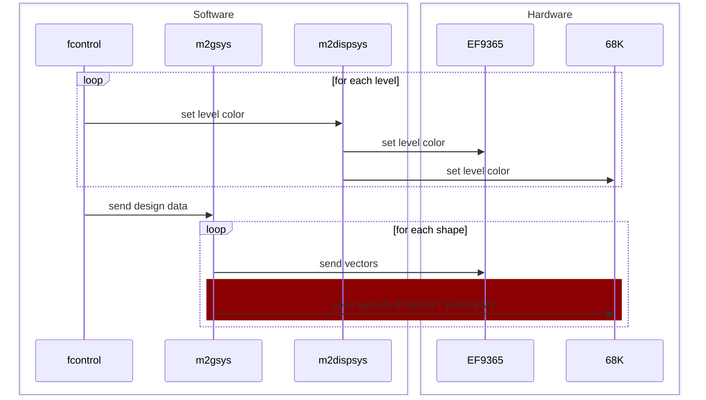

When loading `ebt`, m2dispsys traverses $87D94A0 when it sends the command to the right monitor's EF9365 to draw a line.

A similar command should have been sent to the center (multilevel) monitor as well, i.e. to the 68K. This should be done by sending bytes via card 516, but there is no traffic.

My theory is that m2dispsys draws each shape twice, once to the 9365, once to the 68K. And it does so before proceeding to the next shape.

Let's see what does m2dispsys do when drawing a shape. My theory is that at some point it skips drawing to the 68K for some reason.

Going to trace execution:

```
trace draw_vector.log,,logerror|noloop,{tracelog "PC=%08X SR=%04X SP=%08X D0=%08X D1=%08X D2=%08X D3=%08X D4=%08X D5=%08X D6=%08X D7=%08X A0=%08X A1=%08X A2=%08X A3=%08X A4=%08X A5=%08X A6=%08X\n",pc,sr,a7,d0,d1,d2,d3,d4,d5,d6,d7,a0,a1,a2,a3,a4,a5,a6}
```

We got an almost 370K line file, mostly with alternating logs and CPU instructions, and some logs in between.

Looks like 21269 instructions are executed in 6.7 ms to draw a full shape outline (one square):

```
 86448  0048.035,269,120 [:crate5:08:aesthedes2_gpu:ef9365] ':crate5:04:pme6822:maincpu' (087D94A0): EF9365 draw_vector : Start=(191,257) End=(133,257)
 86659  0048.035,304,240 [:crate5:08:aesthedes2_gpu:ef9365] ':crate5:04:pme6822:maincpu' (087D94A0): EF9365 draw_vector : Start=(133,257) End=(133,316)
 86874  0048.035,339,960 [:crate5:08:aesthedes2_gpu:ef9365] ':crate5:04:pme6822:maincpu' (087D94A0): EF9365 draw_vector : Start=(133,316) End=(191,316)
 87089  0048.035,375,040 [:crate5:08:aesthedes2_gpu:ef9365] ':crate5:04:pme6822:maincpu' (087D94A0): EF9365 draw_vector : Start=(191,316) End=(191,257)
128987  0048.041,990,360 [:crate5:08:aesthedes2_gpu:ef9365] ':crate5:04:pme6822:maincpu' (087D94A0): EF9365 draw_vector : Start=(254,257) End=(195,257)
129202  0048.042,026,080 [:crate5:08:aesthedes2_gpu:ef9365] ':crate5:04:pme6822:maincpu' (087D94A0): EF9365 draw_vector : Start=(195,257) End=(195,316)
129417  0048.042,061,800 [:crate5:08:aesthedes2_gpu:ef9365] ':crate5:04:pme6822:maincpu' (087D94A0): EF9365 draw_vector : Start=(195,316) End=(254,316)
129636  0048.042,097,480 [:crate5:08:aesthedes2_gpu:ef9365] ':crate5:04:pme6822:maincpu' (087D94A0): EF9365 draw_vector : Start=(254,316) End=(254,257)
```

Of which, 20949 between the end of the last segment and the next shape's first segment.

Somwehere in these instructions the CPU figures out what to draw next, the list of segments, and whether to drive the multilevel monitor or not.

-----

Among the functions that are called during this trace, one receives opcodes from `fcontrol` and calls many other functions depending on the opcode. At least one of those functions talks to the 68K. Therefore, it might be that `fcontrol` itself decides what to draw to each monitor. Let's use some breakpoints to inspect the traffic between the two processes.

This is the [protocol](fcontrol_m2dispsys.md) as found by the stochastic parrot.

The following MAME debugger commands must be entered for `:crate5:04:pme6822:maincpu` (press F6 to switch CPU) after the app is loaded, before entering the load command:

```
print d@0802caf0
(should print 8708140; if not, change the occurrence below)

bpset 0x086f6988,1,{ printf "F$Event Ev$Set id=%08X value=%08X payload: %04X/%04X argc=%d %04X %08X %08X %08X %08X %08X %08X",d0,d2,w@8708140,w@8708142,w@8708144,w@87081446,d@8708148,d@870814C,d@8708150,d@8708154,d@8708158,d@870815C ; g }
```

These are sent at startup, before loading the drawing:

```
F$Event Ev$Set id=00020001 value=00000002 payload: 0007/0362 argc=0 0000 000100FD 00010000 00000000 0001003F 00010001 00010001
F$Event Ev$Set id=00020001 value=00000000 payload: 0007/0065 argc=0 0000 000100FD 00010000 00000000 0001003F 00010001 00010001
F$Event Ev$Set id=00010000 value=00000002 payload: 0007/0065 argc=0 0000 000100FD 00010000 00000000 0001003F 00010001 00010001
F$Event Ev$Set id=00010000 value=00000000 payload: 0006/0065 argc=0 0000 0001001F 00010000 00000000 0001003F 00010001 00010001
F$Event Ev$Set id=00010000 value=00000002 payload: 0006/0065 argc=0 0000 0001001F 00010000 00000000 0001003F 00010001 00010001
F$Event Ev$Set id=00010000 value=00000000 payload: 0006/0065 argc=0 0000 00020000 00000002 00000000 0001003F 00010001 00010001
```

At loading:

```
F$Event Ev$Set id=00020001 value=00000002 payload: 0007/0321 argc=4 0000 00010000 00010000 00010000 00010000 00010001 00010001
F$Event Ev$Set id=00020001 value=00000000 payload: 0007/0065 argc=0 0000 00010000 00010000 00010000 00010000 00010001 00010001
F$Event Ev$Set id=00020001 value=00000002 payload: 0007/0321 argc=4 0000 00010001 000100FF 000100FF 000100FF 00010001 00010001
F$Event Ev$Set id=00020001 value=00000000 payload: 0007/0065 argc=0 0000 00010001 000100FF 000100FF 000100FF 00010001 00010001
F$Event Ev$Set id=00020001 value=00000002 payload: 0007/0321 argc=4 0000 00010002 00010005 00010005 00010005 00010001 00010001
F$Event Ev$Set id=00020001 value=00000000 payload: 0007/0065 argc=0 0000 00010002 00010005 00010005 00010005 00010001 00010001
...
F$Event Ev$Set id=00020001 value=00000002 payload: 0007/0321 argc=4 0000 0001003F 000100FF 000100FF 000100FF 00010001 00010001
F$Event Ev$Set id=00020001 value=00000000 payload: 0007/0065 argc=0 0000 0001003F 000100FF 000100FF 000100FF 00010001 00010001
```

The only opcodes seen are the one to set the level colors (0007/0321, see protocol doc), and 0007/0065 with no arguments. No trace of vectors or shapes. Which is surprising, because `m2dispys` drives the EF9365 with shapes and those must come from somewhere. A separate communication channel maybe?

Or maybe the shared data area is used in different ways than with events? Let's add a watchpoint on any writes:

```
wpset 8708140:crate5:04:pme6822:maincpu,4,w
```

The first write by userspace is by 087C46F0, which Ghidra doesn't recognize as neither `fcontrol` nor `m2dispsys`?

Going to find out which module it is. I search for the OS-9 header in the vicinity:
```
find 8600000:crate5:04:pme6822:maincpu,1C46F0,w.4afc,w.0001
```
Closest match is at 870A710. From the memory view, a string pops up: `m2gsys`. Maybe that's the module that actually handles the graphic vectors, while `m2dispsys` is the low-level interface to the displays?

Later we'll try loading `m2gsys` into Ghidra and analyzing it; but first, let's which other writes are done and let's match them with the Ev$Sets done by `fcontrol` (especially, see which ones _don't_ match):

```
wpset 8708140:crate5:04:pme6822:maincpu,20,w,1,{ printf "write @ %08X: %04X (PC=%08X)",wpaddr,wpdata,PC ; g }
bpset 86f6988:crate5:04:pme6822:maincpu,1,{ printf "F$Event Ev$Set id=%08X value=%08X",d0,d2 ; g }
```

We do see writes to the data area without a related F$Event; those may be issued by `m2gsys`. Most interestingly, we see the EF9365 being driven just after those writes. Is it possible that `m2gsys` is only sending draw commands for the side display and not for the multilevel? And how to let it send those commands? A disassembly is in order.

First, dumping `m2gsys` (with 504 as current CPU):

```
save m2gsys.bin,870A710,d@(870A710+4)
```

(the module starts at 870A710, ends at 87D566B, and is 0xcaf5c bytes large)

Then, imported as overlay.

I found an Ev$Set invocation at 87C5EE0.

With these debugger commands we trace events and data from both fcontrol and m2gsys:
```
wpset 8708140:crate5:04:pme6822:maincpu,20,w,1,{ printf "write @ %08X: %04X (PC=%08X)",wpaddr,wpdata,PC ; g }
bpset 86f6988:crate5:04:pme6822:maincpu,1,{ printf "F$Event Ev$Set fcontrol id=%08X value=%08X cmd=%04X/%04X argc=%d",d0,d2,w@8708140,w@8708142,w@8708144 ; g }
bpset 87C5EE0:crate5:04:pme6822:maincpu,1,{ printf "F$Event Ev$Set m2gsys   id=%08X value=%08X cmd=%04X/%04X argc=%d",d0,d2,w@8708140,w@8708142,w@8708144 ; g }
```

We can see that for every cluster of commands sent by m2gsys, there is a cluster of EF9365 commands:

```
write @ 08708140: 0006 (PC=087C46F8)
write @ 08708142: 0262 (PC=087C4706)
write @ 08708148: 0001 (PC=087C4756)
write @ 0870814A: 000D (PC=087C4768)
write @ 0870814C: 0001 (PC=087C4756)
write @ 0870814E: 0001 (PC=087C4768)
write @ 08708144: 0002 (PC=087C486E)
F$Event Ev$Set m2gsys   id=00020001 value=00000002 cmd=0006/0262 argc=2
write @ 08708140: 0006 (PC=087E7AC6)
write @ 08708142: 0065 (PC=087E7AD4)
write @ 08708144: 0000 (PC=087E7AE6)
write @ 08708146: 0000 (PC=087E7AF2)
F$Event Ev$Set m2gsys   id=00020001 value=00000000 cmd=0006/0065 argc=0
write @ 08708140: 0006 (PC=087C46F8)
write @ 08708142: 02BD (PC=087C4706)
write @ 08708148: 0001 (PC=087C4756)
write @ 0870814A: 0012 (PC=087C4768)
write @ 08708144: 0001 (PC=087C486E)
F$Event Ev$Set m2gsys   id=00020001 value=00000002 cmd=0006/02BD argc=1
0034.340,289,160 [:crate5:08:aesthedes2_gpu:ef9365] ':crate5:04:pme6822:maincpu' (087D9544): EF9365 draw_vector : Start=(320,441) End=(379,441)
0034.340,336,880 [:crate5:08:aesthedes2_gpu:ef9365] ':crate5:04:pme6822:maincpu' (087D9544): EF9365 draw_vector : Start=(320,440) End=(379,440)
0034.340,384,600 [:crate5:08:aesthedes2_gpu:ef9365] ':crate5:04:pme6822:maincpu' (087D9544): EF9365 draw_vector : Start=(320,439) End=(379,439)
0034.340,432,320 [:crate5:08:aesthedes2_gpu:ef9365] ':crate5:04:pme6822:maincpu' (087D9544): EF9365 draw_vector : Start=(320,438) End=(379,438)
...
```

Therefore, things may go this way when a design file is loaded:



Let's do the same trace and analysis we did in `m2dispsys`, in `m2gsys`. Get the execution trace of a portion of the loop where it sends vectors, see which functions are hit, and which ones check if they should send commands to `m2dispsys` for the 68K.

Actually, the previously-created `draw_vector.log` already has traces of `m2gsys`. Let's focus on those and see what happens.

```
python3 mame-user-sp-range.py --start-pc 870A710 --end-pc 87D566B
```

SP was at its highest at PC=08736974. That's in `FUN_m2gsys__087368e0`.

Let's make a call graph:

```
python3 mame-call-graph.py --start-pc 870A710 --end-pc 87D566B
```

I've let Copilot analyze the path, generate the Ghidra functions, and see if any "alternative" paths could lead to `m2gsys` to send PIA-driving commands, but it didn't find anything. I guess I'll do this job myself.

Let's have a birds-eye view on how `m2gsys`'s stack is used during the traced dump:
```
python3 mame-sp-chart.py --start-pc 870A710 --end-pc 87D566B
```

Let's focus on the events that led to the first `draw_vector` log line being printed. Four vectors are drawn (for an entire rectangle, I suppose) after `m2gsys` sent an event for command 0006/02BD at trace line 85026. This was preceded by writes to the shared data module:

* `write @ 08708140: 0006 (PC=087C46F8)` @ line 84358 (in `write_command`)
* `write @ 08708142: 02BD (PC=087C4706)` @ line 84360 (in `write_command`)
* `write @ 08708148: 0001 (PC=087C4756)` @ line 84446 (in `write_command_args`)
* `write @ 0870814A: 0012 (PC=087C4768)` @ line 84466 (in `write_command_args`)
* `write @ 08708144: 0001 (PC=087C486E)` @ line 84550 (in `FUN_m2gsys__08718cde`)

By looking at the SP stack, there are three interesting "peaks" before these instructions:

* @ line 83861: PC=0871ACE0 (in `FUN_m2gsys__0871ac64`)
* @ line 79964: PC=0871ACC6 (in `FUN_m2gsys__0871ac64`)
* @ line 79857: PC=08736950 (in `FUN_m2gsys__087368e0`)

Alas, the decompiler of those two functions don't hint at anything like "if (flag == true) call_draw_with_pia()".

The next idea is to get all the callers of `write_command` or `send_command`, see where the command ID is taken, and find how the PIA-driving commands could be sent.

Let's look at the latest call stack...


FUN_086f39cc looks like a mirror copy of `write_command` but for `fcontrol`, and is called by functions that drive the PIA!?

I called it `fcontrol::write_command`. It is called by a single function (`fcontrol::write_command_up`), which is in turns called by many different functions, each specifying a different command ID. Most of them are the PIA-driving ones.
