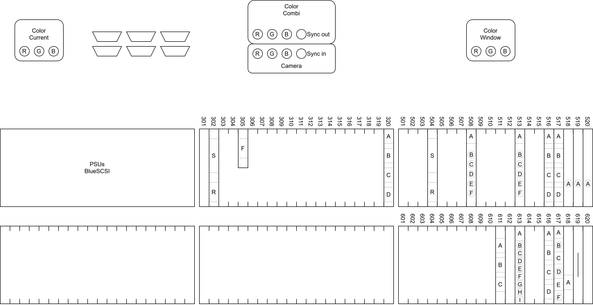
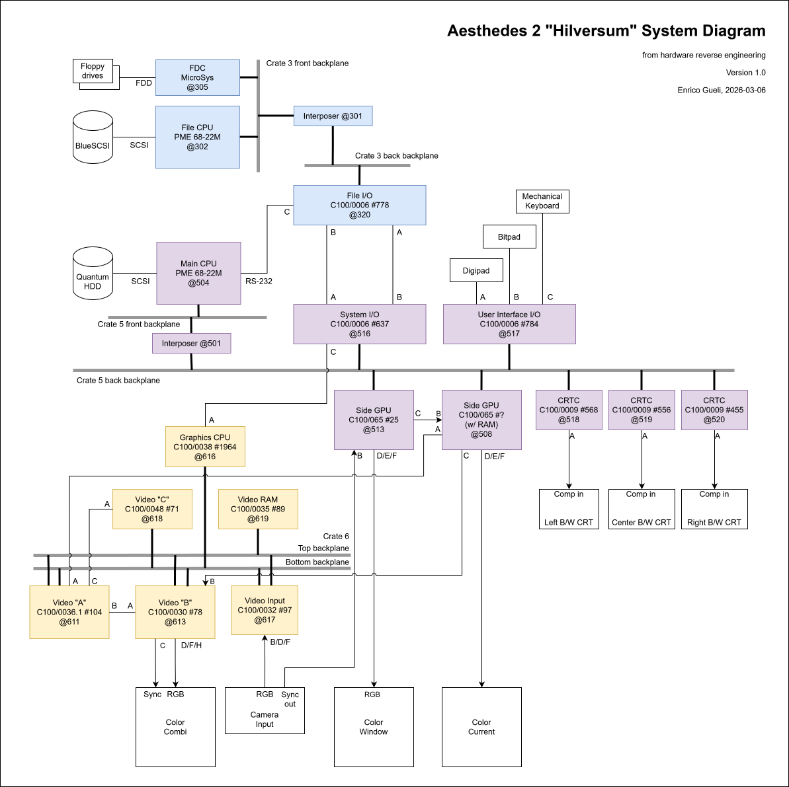

This document collects information about the internal AES2 hardware that can be useful to implement an emulator.

# General information

The Home Computer Museum has two Aesthedes 2. I named them "Hilversum" and "Klokhuis". 

I visited the museum in two separate occasions, on 2024-06-08 and 2026-02-20, and took photos and notes of the Hilversum machine. Most of the information presented here is derived from these visits.

Unless otherwise specified, these pages are about the Hilversum machine.
# System overview

The machine is made of 5 larger components:

* A central unit with power, CPU cards, graphics cards, and three terminal-like CRTs.
* A "desk" for user input, made of a large button matrix ("bitpad"), a digitizer ("digipad") and a mechanical keyboard.
* Three color CRT monitors.

# Central unit

On the back of the unit, the volume is divided into six spaces. The top-left one is almost entirely taken by the power supplies. The other five are VMEBus crates, with backplanes and rail guides.

The following diagram shows how the crates are filled with PCBs:

How to read the diagram:

* I numbered the crates left-to-right, then right-to-bottom: the PSU at top-left corner would be #1, #2 is below it, #3 is at its right and so on.
* Each crate has room for 20 cards. Each card takes a slot. I labeled the slots with a three-digit code, where the fist digit is the crate number and the other two is the slot number, left to right, starting from 1.
  * This numbering scheme is similar to the one used in the original [wiring diagram of the Aesthedes 1](https://www.egueli.com/aesthedes/pics/hcm/Aesthedesbekabeling.jpg). I didn't have that diagram at hand when I numbered the cards, so I went by memory.
* Most of the cards have no edge panel, silkscreen or other indication describing the connectors. To keep track of their wiring, I labeled each connector top-to-bottom, alphabetically starting with A. The PME 68-22M cards are the only ones with clear labels, SCSI and RS-232, so I labeled them S and R respectively.

## Cards overview

Most of the cards are custom-made for the Aesthedes. Each card has a name and a serial number. The name is like C100/xxxx where "xxxx" is an increasing number: higher numbers denote more recent cards. Lower numbers seem to be used for Aesthedes 1 and carried over to the Aesthedes 2, and higher numbers may be specific to the Aesthedes 2. The name is printed on PCB silkscreen, while the serial number is either stamped or written by hand.

## Connections

All the cards are connected with one another, either via VME backplanes on each crate, or via cables on the user-facing edge.

Do note that it may not be a "proper" VMEbus: while the standard describes two connectos 3x32 pins each, called P1 and P2, the bottom "P2" connectors in the Aesthedes have sometimes 2 rows instead. The pinouts need then to be investigated, as the P2 backplane may be something Aesthedes-proprietary.

Backplanes are connected to each other within each crate (via interposer cards), but separated from other crates. Inter-crate communication is made possible by I/O cards and flat cables.

The following subsections provide details about the backplanes. They list all the cards installed into them, and link to the respective page with the card's details.

### Crate 3

There is a "front" and a "back" backplane, made to accommodate different card depths (6U and what I called 6U+). The two backplanes are connected together via an interposer card.

| Type          | Location                                 | Front backplane | Back backplane |
| ------------- | ---------------------------------------- | --------------- | -------------- |
| PME 68-22M    | [302](cards/pme6822/README.md#slot-302)  | Both            |                |
| Microsys FDC  | [305](cards/microsys/README.md#slot-305) | P1 only         |                |
| Aesthedes I/O | [320](cards/aes_io/README.md#slot-320)   |                 | Both           |

The PME@302's SCSI port is connected to a Priam V738 SCSI hard disk.

### Crate 5

There is a "front" and a "back" backplane, made to accommodate 6U and 6U+ cards. The two backplanes are connected together via an interposer card.

| Type           | Card location                            | Front backplane | Back backplane |
| -------------- | ---------------------------------------- | --------------- | -------------- |
| PME 68-22M     | [504](cards/pme6822/README.md#slot-504)  | Both            |                |
| Aesthedes GPU  | [508](cards/aes_gpu/README.md#slot-508)  |                 | Both           |
| Aesthedes GPU  | [513](cards/aes_gpu/README.md#slot-513)  |                 | Both           |
| Aesthedes I/O  | [516](cards/aes_io/README.md#slot-516)   |                 | P2 only        |
| Aesthedes I/O  | [517](cards/aes_io/README.md#slot-517)   |                 | P2 only        |
| Aesthedes CRTC | [518](cards/aes_crtc/README.md#slot-518) |                 | P2 only        |
| Aesthedes CRTC | [519](cards/aes_crtc/README.md#slot-519) |                 | P2 only        |
| Aesthedes CRTC | [520](cards/aes_crtc/README.md#slot-520) |                 | P2 only        |

The PME@504's SCSI port is connected to a Quantum SCSI hard disk.

### Crate 6

There is a single backplane for all the 6U+ cards. The top DIN 41612 connector has 3x32 pins, the bottom one has 2x32 pins, likely a G-64 bus.

For a G-64 bus pinout, see Table 2.4 of [CERN OADC G64 module](https://cds.cern.ch/record/2833363/files/PS-CO-Note-93-79-Tech.pdf).

| Type                | Card location                                 | Backplane usage     |
| ------------------- | --------------------------------------------- | ------------------- |
| Aesthedes "video A" | [611](cards/aes_video_a/README.md#slot-611)   | Both                |
| Aesthedes "video B" | [613](cards/aes_video_b/README.md#slot-613)   | Both                |
| Aesthedes 68000 CPU | [616](cards/aes_68k/README.md#slot-616)       | P2 only             |
| Aesthedes video in  | [617](cards/aes_video_in/README.md#slot-617)  | Both                |
| Aesthedes "video C" | [618](cards/aes_video_c/README.md#slot-618)   | P2 only, 3 rows (*) |
| Aesthedes video RAM | [619](cards/aes_video_ram/README.md#slot-619) | P1 only (**)        |

(*) No idea if the third row is actually connected. We should better look at that backplane.

(**) This card has a 2x32 connector on the bottom backplane but no pin seems connected to any PCB trace.

### Inter-crate cabling

Each crate has a CPU, and each CPU has at least an I/O chip that connects it to another CPU.

Between I/O card at 320 and at 516, there are two flat cables running from one's connector A and the other's connector B and vice versa.

Do note that both flat cables are reversed on one end: pin 1 is on the top side, far from the pin 1 marking on the connector it's attached to. This is intentional, to allow 8-bit parallel data on one side to be received by the other by configuring the I/O ports in the same way at both ends.

# Desk 

The desk is connected to the central unit via three flat cables and some power wires.

For more information, see the [desk page](desk.md).

